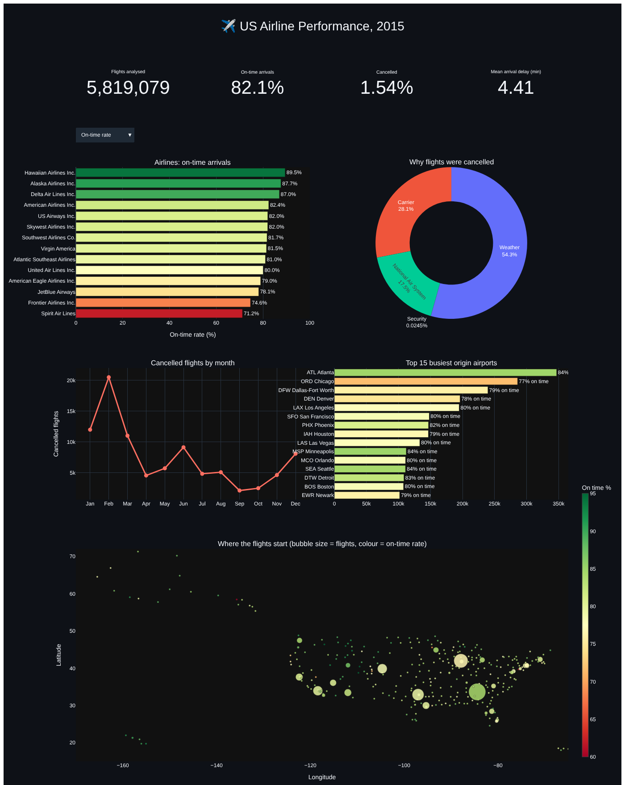
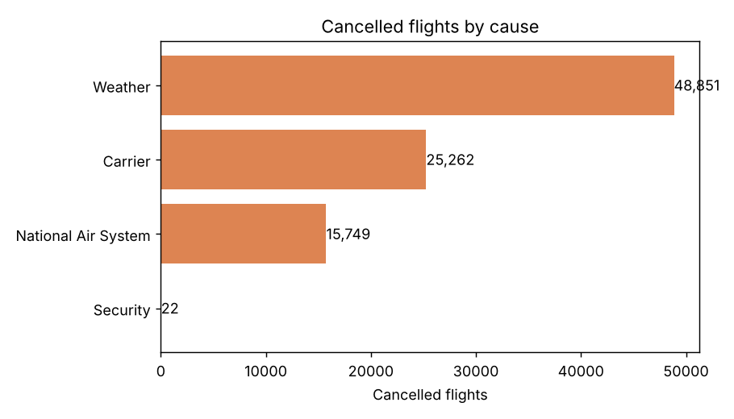
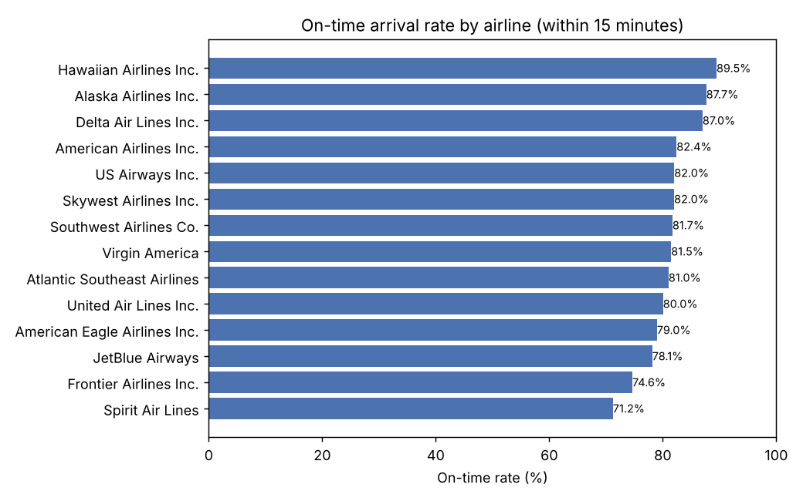
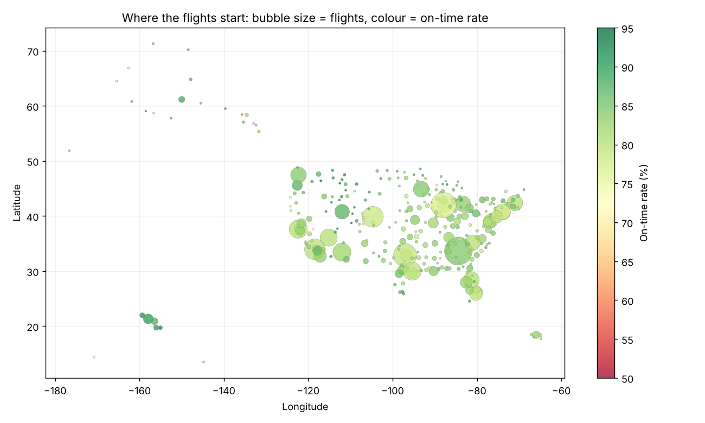
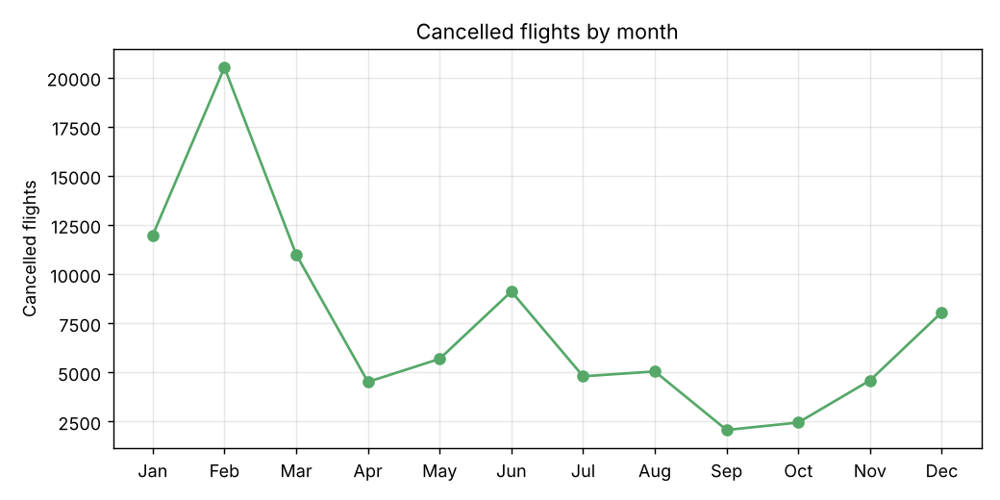

# ✈️ Why Is My Flight Late? US Airline Performance, 2015

> *5.8 million flights. 14 airlines. One question: who actually gets you there on time?*

This project digs into every US domestic flight from 2015 to answer that. It cleans and merges the flight data, measures on-time performance and cancellations, and packages the answers into an **interactive dashboard**, a set of charts, and a pipeline you can rerun yourself.

---

## 🌐 Explore it yourself

**👉 [Open the interactive site](https://jonahcha.github.io/US-Airline-Performance-Delay-Analysis/)**

| | What you get |
|---|---|
| 📊 **[Dashboard](https://jonahcha.github.io/US-Airline-Performance-Delay-Analysis/dashboard.html)** | KPIs, airline rankings, cancellation causes, monthly trends, busiest airports, and a map. Hover, click, and use the dropdown. |
| 🔎 **[Data explorer](https://jonahcha.github.io/US-Airline-Performance-Delay-Analysis/explorer.html)** | Every table behind the dashboard: 14 airlines, 628 airports, 12 months, and 4 cancellation causes. Search, sort any column, and click a row for its full breakdown. |
| 📄 **[Original report](docs/Report_Of_Airlines.pdf)** | The earlier written analysis, with a comparison to the verified results below. |



> **First time?** Turn on GitHub Pages once: go to **Settings → Pages → Deploy from a branch**, choose `main` and the `/docs` folder, then save. The links above go live within a minute or two.
>
> **No Pages?** Download the repo and open `docs/index.html` in any browser. Everything works offline.

---

## 🏆 The headline numbers

| | |
|---|---|
| ✈️ Flights analysed | **5,819,079** |
| 🕒 On time (arrived within 15 min) | **82.1%** |
| ❌ Cancelled | **1.54%** (89,884 flights) |
| ⏱️ Average arrival delay | **4.41 minutes** |

---

## 🌦️ Why flights get cancelled



The weather is the main villain. It caused **54.3%** of all cancellations, more than carriers (28.1%) and the air traffic system (17.5%) combined.

*(Security cancellations: 22. Thankfully, rare.)*

---

## 🥇 Airline leaderboard



| Rank | Airline | On time | Flights |
|---|---|---|---|
| 🥇 | Hawaiian Airlines | **89.5%** | 76,041 |
| 🥈 | Alaska Airlines | **87.7%** | 171,439 |
| 🥉 | Delta Air Lines | **87.0%** | 870,275 |
| 🐢 | Frontier Airlines | 74.6% | 90,090 |
| 🐌 | Spirit Air Lines | 71.2% | 115,193 |

Hawaiian and Alaska are the ones to beat. Spirit runs the most cancellation-prone schedule, with more than one in four flights late.

---

## 🛫 The busiest airports



- 🏙️ **Atlanta (ATL)** is the busiest airport: 346,836 departures, 84.2% on time.
- 🌬️ **Chicago O'Hare (ORD)** is the least punctual of the top airports: 76.6% on time.
- ☀️ **Minneapolis (MSP)** is one of the most punctual big hubs, at 84.3%.

---

## 📅 When cancellations happen



- ❄️ **February** is the worst month, with 20,517 cancellations.
- 🌧️ January and March follow, at around 11,000 to 12,000 each.
- 🌸 **September** is the calmest, at 2,075 cancellations.

---

## 🧪 Myth-busting: the old dashboard

The project started with a Power BI dashboard, and some of its headline figures don't hold up against the data. The table below compares them with the verified results.

| What the old dashboard said | What the data says | Verdict |
|---|---|---|
| About 3 million flights | 5.8 million | ❌ |
| 79% on time | 82.1% | ❌ |
| 7.2-minute average delay | 4.41 minutes | ❌ |
| National Air System causes 57% of cancellations | 17.5%. Weather causes 54.3% | ❌ |
| Hawaiian and Alaska lead on-time performance | Confirmed | ✅ |
| February and June see cancellation peaks | February confirmed. June is moderate | 🤏 |

Old dashboard screenshot: [docs/images/dashboard.jpg](docs/images/dashboard.jpg). Full report: [docs/Report_Of_Airlines.pdf](docs/Report_Of_Airlines.pdf).

---

## 🚀 Run it yourself

```bash
python -m venv .venv
source .venv/bin/activate        # Windows: .venv\Scripts\activate
pip install -r requirements.txt

# 1. Put flights.csv in data/ (see data/README.md, about 560 MB)
# 2. Run the analysis
python airline_analysis.py --flights data/flights.csv --outdir docs
```

That regenerates `docs/results.txt`, the four charts, `docs/dashboard.html`, and `docs/explorer.html`. The pipeline reads the flights file in chunks, so it runs on a laptop with about 4 GB of memory.

Run the tests:

```bash
pip install -r requirements-dev.txt
pytest
```

The tests use small synthetic datasets, so they don't need the flights file. CI runs them on every push. ✅

---

## 🧭 How it works

1. **Load:** flights, airlines and airports.
2. **Clean:** blank delay reasons become 0, and a proper date column is built.
3. **Merge:** airline names and airport details are attached to every flight.
4. **Count:** on-time arrivals, cancellations, causes, airports and months, one chunk at a time.
5. **Show:** charts, a text report, and an interactive dashboard.

On-time means arriving within 15 minutes of schedule, the FAA definition. The rate uses operated flights only, so cancelled flights don't count towards it.

---

## 🗂️ Project layout

```
airline_analysis.py    # cleaning, merging, counting, command line
dashboard.py           # builds the interactive dashboard
explorer.py            # builds the searchable data explorer
plots.py               # static charts for this README
data/                  # airlines and airports (included), flights.csv (download)
docs/                  # index.html (site home), dashboard.html, explorer.html, results, charts
tests/                 # pytest suite on synthetic data
```

## 📝 Notes

- The original work was a Jupyter notebook with hardcoded Windows paths. It's now a script with command-line options.
- The Power BI file isn't included. The dashboard here covers the same ground without it.
- The cleaning step keeps origin and destination airport details separate, so they can't get mixed up.

## 📜 Licence and data

Code: MIT, see [LICENSE](LICENSE). Flight data: US Department of Transportation, Bureau of Transportation Statistics. Airline and airport lookup tables come from the original project.
