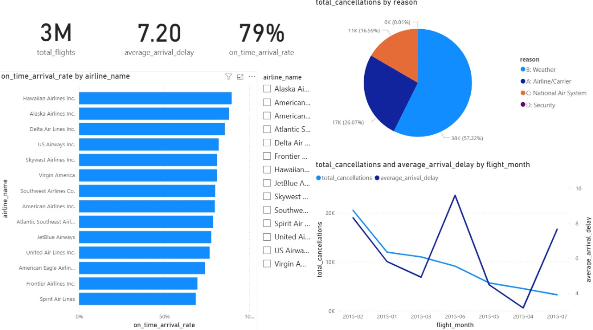

# US Airline Performance: Delays and Cancellations (2015)

An analysis of on-time performance, cancellation causes, and monthly trends for US airlines, built on the 2015 US Department of Transportation flight data. The pipeline cleans and merges the data, computes the metrics, and produces the charts below. A Power BI dashboard was built from the same data.

## Dashboard



The Power BI dashboard above was built earlier from the same 2015 data. Its headline figures did not match a re-run of the data, so the verified results are given below, followed by the comparison.

Full write-up: [docs/Report_Of_Airlines.pdf](docs/Report_Of_Airlines.pdf).

## Results (verified)

Generated by `airline_analysis.py` from the 2015 BTS flight data (`docs/results.txt`):

| Metric | Value |
|---|---|
| Total flights | 5,819,079 |
| Cancelled flights | 89,884 (1.54%) |
| On-time arrivals (within 15 min, operated flights) | 82.1% |
| Mean arrival delay (operated flights) | 4.41 minutes |

**Cancellation causes** (share of cancelled flights):

| Cause | Flights | Share |
|---|---|---|
| Weather | 48,851 | 54.3% |
| Carrier | 25,262 | 28.1% |
| National Air System | 15,749 | 17.5% |
| Security | 22 | 0.0% |

**On-time rate by airline** (top and bottom):

| Airline | On-time | Flights |
|---|---|---|
| Hawaiian Airlines Inc. | 89.5% | 76,041 |
| Alaska Airlines Inc. | 87.7% | 171,439 |
| Delta Air Lines Inc. | 87.0% | 870,275 |
| ... | | |
| Frontier Airlines Inc. | 74.6% | 90,090 |
| Spirit Air Lines | 71.2% | 115,193 |

Cancellations peak in February (20,517), then January (11,982) and March (11,002). June has 9,120. The smallest months are September (2,075) and October (2,454).

Charts: `docs/images/cancellation_reasons.png`, `docs/images/ontime_by_airline.png`, `docs/images/monthly_cancellations.png`.

To reproduce, download the flights data as described in [data/README.md](data/README.md), then run:

```
python airline_analysis.py --flights data/flights.csv --outdir docs
```

On-time means arriving within 15 minutes of schedule, the FAA definition. The rate uses operated flights only, which excludes cancellations.

### Comparison with the original dashboard

| Claim (original dashboard) | Verified result | Status |
|---|---|---|
| About 3 million flights | 5.8 million | Not matched |
| On-time rate about 79% | 82.1% (63.5% if "on time" means arriving on or before schedule) | Not matched |
| Average arrival delay about 7.2 minutes | 4.41 minutes | Not matched |
| National Air System causes over 57% of cancellations | 17.5%. Weather is the largest cause at 54.3% | Not matched |
| Hawaiian and Alaska have the highest on-time rates | Confirmed (89.5% and 87.7%) | Matched |
| Cancellation peaks in February and June | February peak confirmed. June is moderate, and January, March and December are also high | Partly matched |

The original dashboard's source data or filters aren't in this repo, so the difference can't be traced. The results above are the ones this repo can reproduce from the BTS file.

## What the pipeline does

1. **Load** flights, airlines and airports.
2. **Clean.** Blank delay-reason fields are set to 0. A `FLIGHT_DATE` column is built from year, month and day.
3. **Merge.** Airline names are joined on the carrier code. Origin and destination airport details are joined separately, with `ORIGIN_INFO_` and `DEST_INFO_` prefixes.
4. **Summarise.** Cancellations and their causes, on-time rates by airline, mean arrival delay, and monthly cancellations.
5. **Report.** Writes `results.txt` and the three charts.

## Setup

```bash
python -m venv .venv
source .venv/bin/activate        # Windows: .venv\Scripts\activate
pip install -r requirements.txt
```

Get the flights data as described in [data/README.md](data/README.md), and save it as `data/flights.csv`. The file is about 560 MB and isn't stored in the repo.

## Tests

```bash
pip install -r requirements-dev.txt
pytest
```

The tests use small synthetic datasets, so they run without the flights file. CI runs them on every push.

## Project layout

```
airline_analysis.py    # cleaning, merging, metrics, CLI
plots.py               # chart generation
data/                  # airlines and airports (included); flights.csv (download)
docs/                  # results, report, dashboard image, charts
tests/                 # pytest suite on synthetic data
```

## Notes

- The flights file is read in 500,000-row chunks and summarised as it goes, so the full dataset runs on a machine with about 4 GB of memory.
- The original work was a Jupyter notebook with hardcoded Windows paths. It has been replaced by `airline_analysis.py`, which takes file paths as options.
- The Power BI file (`.pbix`) isn't included. The charts in this repo reproduce the main analysis without it.
- The cleaning step now keeps origin and destination airport details separate. The notebook's default merge suffixes mixed them up.

## Licence and data source

Code: MIT, see [LICENSE](LICENSE). Flight data: US Department of Transportation, Bureau of Transportation Statistics. Airline and airport lookup tables are from the original project.
